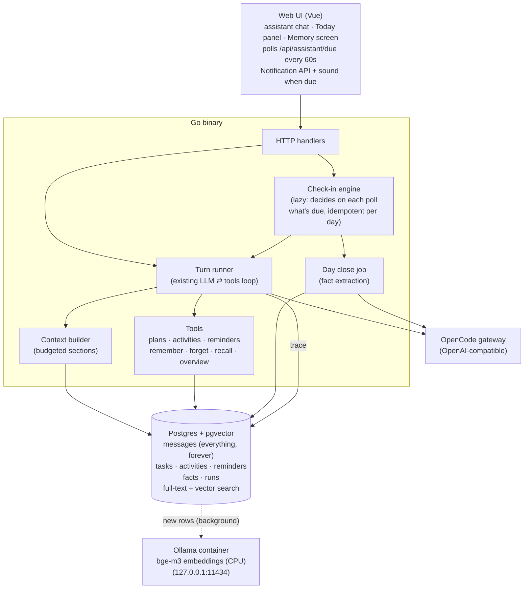
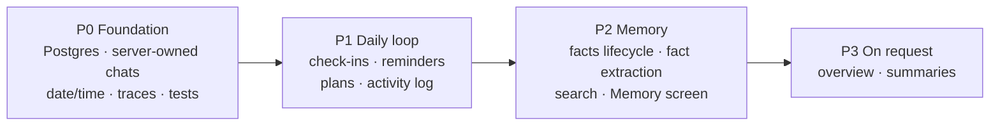

# Personal assistant: evolution plan (v2, narrowed scope)

Written 2026-11-24 against commit `b9700aa` plus the uncommitted `memory.go`. Builds on [memory-research.md](memory-research.md), which stays the reference for memory prior art.

**v2 change:** scope narrowed to a basic daily assistant. Calendar, email, Telegram, external actions and proactive advice are parked (§9).

**v2.1 (gap review):** day boundary at 04:00, closed days recorded, check-ins that survive failures and don't block the page, one turn at a time per thread, reminders written into the chat, "forget" also hides the source messages, re-embedding after edits, exact vector search instead of an HNSW index, the REST endpoints behind the Today panel and Memory screen, and browser tab-throttling risks.

---

## 0. Scope

**The assistant does four things:**

1. **Reminds.** Morning and evening check-ins every day, plus reminders you ask for ("remind me at 3pm to…", "every day at 9 remind me to…").
2. **Asks what you want to do.** Morning: "What do you want to get done today?" It records the answer as plans.
3. **Asks how it went.** Evening: "How did today go?" It records what you did and updates the plans (done, moved, dropped).
4. **Remembers everything.** Every message is kept forever, what you plan and do becomes records, and durable facts about you are kept and updated. It can find any of this later.

**And one rule: no advice unless you ask.** Check-ins ask questions and reflect back what *you* said ("yesterday you planned X and Y"). Recommendations happen only when you ask ("what should I focus on?"), and then they're grounded in your records.

**Where it lives:** the existing web UI only. Check-ins and reminders show up in the assistant's chat, with a desktop notification and sound while a tab is open. With the browser closed, nothing reaches you; whatever came due is waiting the next time you open it.

---

## 1. Current state (still accurate)

```
browser (Vue, localStorage: one chat per character)
   │  POST /api/chat {characterId, sessionId, model, messages[≤200]}   ← whole history every time
   ▼
main.go ──┬── runChat: openai-go → OpenCode gateway, tool loop ≤10 steps (web_search, fetch_url)
          └── runClaude: `claude -p` subprocess, history flattened into stdin, no app tools
memory.go: profile.md + memory/<char>.json appended to the system prompt (read-only)
```

| Area | State | For this scope |
|---|---|---|
| Conversations | Only in browser localStorage, one chat per character; server is stateless | **Blocker.** The server can't create a check-in into a chat it doesn't have, and can't remember what it never stores. Clearing browser storage deletes everything. |
| Message cap | `validate()` rejects >200 messages; the frontend resends the full history | **Will break** after ~100 exchanges. A daily chat hits that in weeks. |
| Date/time | Not in the prompt | **Blocker** for "what did I do today", morning vs evening, reminders. |
| Memory | `memory.go`: profile + facts injected; nothing writes; missing facts file logged as an error every request | **Keep** as the always-in-prompt layer; add a write path, lifecycle and search. |
| Tool loop | Correct, small, recoverable tool errors | **Keep**, make it callable without an HTTP request (the check-in engine needs it). |
| Tool registry | One shared args struct `{Query, URL}` for all tools | **Refactor**: each tool needs its own typed args. |
| Characters | persona + model + tool allowlist, validated at startup | **Keep**: the assistant is one more character. |
| Claude route | Can't call app tools | **Not used by the assistant** (D2). Personas keep it. |
| Background work, scheduling | None | Needed, but small: lazy, on-demand (D4). |
| Traces, tests | `log.Printf`; tests only for fetch/SSRF | Add a trace table and a fake model for loop tests. |

---

## 2. Target architecture

One Go process, one Postgres database (a container next to SearXNG in `docker-compose.yml`), the existing Vue app.



**Boundaries:**
- **Turn runner:** the current `runChat` loop behind a `Model` interface. It persists every message and a trace. It knows nothing about HTTP. **Only one turn runs per conversation at a time** (a per-conversation lock), so a check-in can't interleave with a reply you're waiting for; the check-in waits its turn.
- **Check-in engine:** a plain function, `Due(now)`. It creates today's check-in if one is due and missing, closes past days, and fires due reminders. Because the UI calls it on every poll and on page load, no always-on scheduler is needed. The poll never waits on an LLM: it starts the work in a background goroutine (one at a time, guarded by a mutex) and returns immediately; the new message shows on the next poll.
- **Tools** are the only way the model changes data. Each validates its typed arguments in Go.
- **Day close job:** one structured LLM call per finished day that pulls durable facts out of the day's messages. Its output is validated and then applied by plain Go code.
- **Context builder:** a pure function `(store, conversation, user message, now) → prompt sections`, tested with golden files.

### 2.1 The daily loop

```mermaid
sequenceDiagram
  participant UI as Web UI
  participant D as Check-in engine
  participant T as Turn runner
  participant DB as Postgres

  UI->>D: GET /api/assistant/due (page load or 60s poll, 07:42)
  D->>DB: today's thread exists? morning check-in done?
  D->>DB: yesterday closed? (no → day close job: extract facts)
  D->>T: Turn(today's thread, trigger: morning_checkin)
  T->>DB: context: profile, facts, last 7 days from records, open plans
  T-->>DB: "Morning! Yesterday you planned A and B; B is still open. What do you want to do today?"
  D-->>UI: new message + due reminders
  UI->>UI: Notification + sound if the tab is hidden
  UI->>T: "B, then gym. And remind me at 3 to call mom"
  T->>DB: plan_tasks(B: today, gym: today), remind_me("call mom", 15:00)
  T-->>UI: "✓ planned 2 · ⏰ 15:00 call mom (undo)"
  Note over UI,D: 15:00 poll → reminder due → notification
  Note over UI,D: 21:00 poll → evening check-in: "How did today go? B, gym?"
  UI->>T: "did B, skipped gym, also fixed a prod bug for 2h"
  T->>DB: complete_task(B), update_task(gym → tomorrow?)… asks, log_activity(prod bug, 120m)
```

### 2.2 Memory: "remember everything" made concrete

**Every agent has its own memory.** What you tell Ria, only Ria knows; the assistant and Socrates do not, unless you tell them too. The model is the real world: what you tell one person is not known by another. Messages are already owned by `conversations.character_id`, and every fact carries its `character_id`. Isolation is enforced in the store (every fact and message read/search takes a character id; there is no "all characters" mode), not in a prompt. Only the Memory screen's REST endpoints cross agents, and they take an explicit `character`.

`profile.md` stays shared: you write it, and every agent sees that text. It is the user's own file, not something an agent learned.

Not everything fits in a prompt. So "remember everything" means **everything is stored, nothing is deleted without you, the important parts are always in front of the model that was told, and the rest can be found.**

| Layer | What | Stored as | Written by | In context |
|---|---|---|---|---|
| **Raw record** | Every message, every tool call | `messages`, `tool_calls` (owner via `conversations.character_id`) | Turn runner, automatically | The agent's own thread (rolling summary if long) |
| **What you do** | Plans and what happened | `tasks`, `activities`, `reminders` | Tools, during chat | Today's plans, done items, due reminders |
| **What's true about you** | Preferences, people, circumstances, goals | `profile.md` (you write it, shared), `facts.character_id` (one owner each) | You; each agent's own `remember` tool; the day close job for that agent | That agent's core facts always; its own facts by search |
| **Recent days** | What happened each day | Nothing extra: built from `activities` + `tasks` on the fly | – | The last 7 days, as a digest from records (assistant only) |
| **Search** | Find anything above, by words *and* by meaning (across Indonesian/English) | `tsvector` + GIN indexes; `embedding` columns (pgvector); both filtered by owner | Automatic (embeddings by a background worker) | The agent's own top hits for your message, plus its `recall` tool |

- **Facts are superseded, not overwritten.** "I live in Bali" → "I moved to Jakarta" marks the old fact `superseded` with an end date. "Where did I live last year?" still works, and a wrong update can be reverted. Only you can hard-delete ("forget that"). A fact can only supersede a fact with the same owner, and `forget` resolves only the calling agent's facts.
- **Every character with memory gets the full stack, scoped to itself:** `profile.md`, its own core facts, pre-retrieval over its own messages and facts, and `remember` / `forget` / `recall`. Daily records (tasks, activities, reminders, check-ins) stay assistant-only. The `context` setting is `"memory"` (default) or `"none"`; `"none"` turns all of it off, including the day-close extraction for that character.
- **Every fact keeps its source** (you, the tool, or extraction, plus the message id). The Memory screen shows "from: chat on 3 Dec" and a character selector: facts, search, edit, history, forget and forget-day act on the selected agent.
- **Extracted facts are applied, but always shown.** The day close job runs once per (day, character), sees only that character's messages and facts, and adds what it learned to that owner. The assistant's evening check-in lists only its own new facts ("I noted: …"). You correct it in chat or on the Memory screen. Web content can't write memory in the turn it was read (D3's guard), and anything the close job extracts is listed for you. If the extraction turns out sloppy (high correction rate, §7), switch to propose-then-confirm.
- **The model is told to search before saying "I don't know"** about the past. The eval checks that it actually does (§7).

---

## 3. Decisions

| # | Decision | Choice | Why / trade-off |
|---|---|---|---|
| D1 | Storage | **Postgres 17 + pgvector** (`pgvector/pgvector` image) in the existing `docker-compose.yml`; Go driver `pgx`; embedded numbered migrations. | Chosen over SQLite for pgvector: vector search is likely needed because you write in both Indonesian and English, and keyword search can't match across languages. Costs: one more container, tests need a running Postgres, backups via `pg_dump`. |
| D2 | Model route | The assistant runs on the **OpenCode (OpenAI-compatible) route**, where app tools work. Pick the model with the tool-call eval (L-10). | The Claude CLI route can't call app tools without an MCP bridge. Keep the route for the personas. |
| D3 | Assistant's tools | The assistant also gets **`web_search` / `fetch_url`** and replaces the General agent (2026-11-25). **Guard:** once a web tool runs in a turn, `remember` and `forget` are refused for the rest of that turn; the user confirms in their own next message. Plans and reminders stay allowed after a search. | One agent for the day and for questions. Web text can't write memory in the same turn. It can still reach the day-close job through the assistant's replies (as General's chats already did), and every extracted fact is shown in the evening ("I noted: …"). If the correction rate (§7) shows planted facts, make the close job skip turns that used web tools. General's Claude CLI models are gone (D2: that route can't call app tools). |
| D4 | Scheduling | **Lazy, on demand.** The UI polls `/api/assistant/due` every 60 s and on load; the server decides what's due, with uniqueness per (day, kind) | You chose web-only, so reminders can't reach you without a tab anyway. That means no always-on scheduler and no systemd requirement, and missed check-ins are handled for free. Rule: a missed morning check-in is skipped once the evening one is due. |
| D5 | Conversation shape | **One assistant thread per day** (`daily:2026-12-01`); you can scroll back through past days. **A day starts at 04:00 local** (`day_starts_at` setting), so chatting at 00:30 still belongs to the day before, and that day isn't closed under you. | Keeps the context bounded. Continuity comes from records, facts and search, not from one endless chat. |
| D6 | Recommendations | **Only when asked**: a persona rule, plus check-in instructions that only allow questions and reflecting back. When asked, the model calls `get_overview` and cites the items it found. | "Yesterday you planned X" is a reminder of your own words. "You should do X" is advice, and the eval checks for it. |
| D7 | Retrieval | **Hybrid:** Postgres full-text (`simple` config) + pgvector cosine, merged with reciprocal rank fusion and a recency boost, in one SQL query. Embeddings from **local Ollama** running the open-weight **`bge-m3`** (multilingual, 1024 dims, 8k context) through its OpenAI-compatible `/v1/embeddings`, so the existing `openai-go` client works with a different base URL. Runs in the Compose stack as a CPU container (`ollama/ollama`, port published to `127.0.0.1:11434`, named model volume), because the target is a VPS without a GPU; no `nvidia-container-toolkit`, no systemd unit. The app uses it only when `EMBEDDINGS_URL` is set (opt-in until the comparison is recorded); otherwise search stays keyword-only. CPU is slower than the RTX 3050 this started on, so M-10 measures texts/s and query latency on the VPS and the ~1 s query timeout is revisited if a short query exceeds it. Built keyword-first; vectors added as the last Phase 2 step, measured against the keyword baseline. | bge-m3 is multilingual, free to run, keeps your text on your own server, and its 1024 dims are small enough to store and scan cheaply. Alternatives: `qwen3-embedding` (0.6B, also open-weight) locally, or `baai/bge-m3` via OpenRouter (~$0.01 per million tokens) if the PC setup becomes a burden. Don't mix sources for one model: vectors can differ slightly. Changing the model later means re-embedding everything; `embedding_model` records which model made each vector. |
| D8 | Agent topology | One assistant loop + one background job type. No multi-agent setup. | About 12 tools fits easily in one agent. |
| D9 | Privacy is isolation between agents | Your log and facts go to the OpenCode gateway's upstream model. Embeddings are computed locally and never leave your machine. **Memory is per agent:** each fact and message read takes a `character_id`, and no agent can read another's facts or messages. Personas get the full memory stack scoped to themselves, including `remember` / `forget` / `recall`; only the user-written `profile.md` is shared. | The real-world model: what you tell one person is not known by another. Isolation lives in the store, so a prompt mistake cannot leak it. Shared memory between agents is parked (§9) as an explicit future opt-in. |
| D10 | Code structure | Split out of `package main` only where a seam is needed: `store`, `llm`, `tools`, `assistant` | Fakes go in at the seams; more layers would be ceremony. |

---

## 4. Data model

Postgres 17 from the `pgvector/pgvector` image, so the vector extension is there when Phase 2 needs it. Timestamps are `timestamptz`; days are `date` in your timezone (`TZ`, default `Asia/Makassar`). Migrations are numbered `.sql` files embedded in the binary and tracked in a one-row `schema_version` table (no migration library).

```sql
-- Phase 0: everything said, forever
CREATE TABLE conversations (
  id text PRIMARY KEY,                       -- uuid, or 'daily:YYYY-MM-DD' for the assistant
  character_id text NOT NULL,
  day date,                                  -- set for daily threads
  summary text, summary_upto bigint,         -- rolling summary of messages past the window
  created_at timestamptz NOT NULL DEFAULT now(), updated_at timestamptz NOT NULL DEFAULT now()
);
CREATE TABLE runs (                          -- trace: one per turn or job
  id bigint GENERATED ALWAYS AS IDENTITY PRIMARY KEY,
  kind text NOT NULL, conversation_id text REFERENCES conversations(id), model text NOT NULL,
  context jsonb,                             -- which sections/ids went into the prompt
  status text NOT NULL, error text, input_tokens int, output_tokens int,
  started_at timestamptz NOT NULL DEFAULT now(), ended_at timestamptz
);
CREATE TABLE messages (
  id bigint GENERATED ALWAYS AS IDENTITY PRIMARY KEY,
  conversation_id text NOT NULL REFERENCES conversations(id),
  role text NOT NULL,                        -- user | assistant | tool | trigger
  content text NOT NULL,
  tool_calls jsonb, tool_call_id text,
  run_id bigint REFERENCES runs(id),
  created_at timestamptz NOT NULL DEFAULT now(),
  forgotten_at timestamptz,                  -- set by "forget": excluded from search, context and fact extraction
  search tsvector GENERATED ALWAYS AS (to_tsvector('simple', content)) STORED  -- 'simple': no stemming, safe for mixed Indonesian/English
);
CREATE INDEX messages_search ON messages USING gin (search);
CREATE INDEX messages_conv ON messages (conversation_id, id);
CREATE TABLE tool_calls (
  id bigint GENERATED ALWAYS AS IDENTITY PRIMARY KEY,
  run_id bigint NOT NULL REFERENCES runs(id),
  name text NOT NULL, args jsonb NOT NULL, result text,
  undo jsonb,                                -- inverse operation, for write tools
  status text NOT NULL,                      -- ok | error | undone
  created_at timestamptz NOT NULL DEFAULT now()
);

-- Phase 1: the daily loop
CREATE TABLE projects (
  id bigint GENERATED ALWAYS AS IDENTITY PRIMARY KEY,
  name text NOT NULL, created_at timestamptz NOT NULL DEFAULT now()
);
CREATE UNIQUE INDEX projects_name ON projects (lower(name));
CREATE TABLE tasks (                         -- "what I want to do"
  id bigint GENERATED ALWAYS AS IDENTITY PRIMARY KEY,
  title text NOT NULL, notes text,
  project_id bigint REFERENCES projects(id),
  status text NOT NULL DEFAULT 'open' CHECK (status IN ('open','done','dropped')),
  planned_on date,                           -- day you intend to do it
  due_on date,
  times_moved int NOT NULL DEFAULT 0,        -- planned_on pushed forward; for "what keeps slipping" when asked
  created_at timestamptz NOT NULL DEFAULT now(), updated_at timestamptz NOT NULL DEFAULT now(),
  completed_at timestamptz,
  source_message_id bigint REFERENCES messages(id)
);
CREATE INDEX tasks_open ON tasks (planned_on) WHERE status = 'open';
CREATE TABLE activities (                    -- "what I did"
  id bigint GENERATED ALWAYS AS IDENTITY PRIMARY KEY,
  day date NOT NULL,
  description text NOT NULL,
  minutes int CHECK (minutes BETWEEN 1 AND 1440),  -- NULL when you didn't say; never guessed
  project_id bigint REFERENCES projects(id), task_id bigint REFERENCES tasks(id),
  source_message_id bigint REFERENCES messages(id),
  created_at timestamptz NOT NULL DEFAULT now()
);
CREATE INDEX activities_day ON activities (day);
CREATE TABLE reminders (
  id bigint GENERATED ALWAYS AS IDENTITY PRIMARY KEY,
  text text NOT NULL,
  remind_at timestamptz NOT NULL,            -- next firing
  repeat text CHECK (repeat IN ('daily','weekdays')),  -- NULL = once
  status text NOT NULL DEFAULT 'pending',    -- pending | fired | cancelled
  fired_at timestamptz,
  source_message_id bigint REFERENCES messages(id),
  created_at timestamptz NOT NULL DEFAULT now()
);
CREATE TABLE checkins (                     -- also records which days are closed
  day date NOT NULL,
  kind text NOT NULL,                        -- morning | evening | close (day-close job, Phase 2)
  character_id text NOT NULL,                -- the close job claims one (day, character) at a time
  status text NOT NULL,                      -- pending | sent | failed | skipped  ('sent' = done, for close)
  attempts int NOT NULL DEFAULT 0,
  message_id bigint REFERENCES messages(id), run_id bigint REFERENCES runs(id),
  updated_at timestamptz NOT NULL DEFAULT now(),
  PRIMARY KEY (day, kind, character_id)      -- idempotency: two tabs can't double-send; a failed
                                             -- character retries alone without re-applying the others
);
CREATE TABLE settings (key text PRIMARY KEY, value text NOT NULL);
  -- tz (default from TZ env, else Asia/Makassar), day_starts_at '04:00', morning_at, evening_at, jobs_model

-- Phase 2: memory. Facts are per agent: character_id is the agent that was told.
CREATE TABLE facts (
  id bigint GENERATED ALWAYS AS IDENTITY PRIMARY KEY,
  character_id text NOT NULL,
  text text NOT NULL CHECK (length(text) <= 300),
  category text NOT NULL DEFAULT 'general',  -- preference | person | circumstance | goal | work | health | general
  core boolean NOT NULL DEFAULT false,       -- always in context
  status text NOT NULL DEFAULT 'active',     -- active | superseded | forgotten
  source_kind text NOT NULL,                 -- user | tool | extraction
  source_message_id bigint REFERENCES messages(id),
  superseded_by bigint REFERENCES facts(id),
  valid_from date NOT NULL, valid_to date,
  last_used_at timestamptz, use_count int NOT NULL DEFAULT 0,
  created_at timestamptz NOT NULL DEFAULT now(), updated_at timestamptz NOT NULL DEFAULT now(),
  search tsvector GENERATED ALWAYS AS (to_tsvector('simple', text)) STORED
);
CREATE INDEX facts_search ON facts USING gin (search);
CREATE INDEX facts_active ON facts (character_id, status, core);

-- Phase 2, last step: semantic search (M-10)
CREATE EXTENSION IF NOT EXISTS vector;
ALTER TABLE messages ADD COLUMN embedding vector(1024), ADD COLUMN embedding_model text;
ALTER TABLE facts    ADD COLUMN embedding vector(1024), ADD COLUMN embedding_model text;
-- No HNSW index at first: an exact scan over tens of thousands of rows takes tens of ms, and it stays
-- correct with filters (forgotten_at, dates). An approximate HNSW index can return fewer than k rows
-- when combined with filters. Add one (with pgvector's iterative scan) only when recall queries pass ~100 ms.
```

**Rule of thumb:** anything you'd ask "how many / how long / which / what's left" about is a row (tasks, activities, reminders). Everything else is a fact or stays in the raw messages, which are searchable.

**Migration from today:** `profile.md` stays a file you edit. `memory/<char>.json` facts are imported once as the **assistant's** facts (`active, source_kind='user'`); personas never had their own files and do not inherit them. Existing localStorage chats are imported once by the frontend. Facts added in a fresh per-agent database start empty; the rebuild was from an empty database, with no backfill (2026-11-25).

**Left out on purpose:** goals as a table (they're facts with `category='goal'` until you need progress tracking), people as a table (facts with `category='person'`), subtasks, priorities, recurring tasks (recurring *reminders* cover "every day…").

---

## 5. Roadmap

Sizes for one person part-time: **S** ≈ an evening, **M** ≈ 2–4 evenings, **L** ≈ a week+.

### Phase 0: Foundation

1. **Objective:** The server owns and stores every conversation. Every turn is traced and knows the current date and time. The loop is testable.
2. **Current gap:** Browser-only history, the 200-message limit, no date, no traces, a shared tool args struct.
3. **Proposed solution:** Postgres store; conversations/messages/runs/tool_calls; a `Model` interface (OpenAI-compatible, Claude CLI and fake adapters); a typed tool registry; context v0 (persona, memory block, **now + weekday + timezone**, last N messages); the frontend loads history from the server and sends only the new message.
4. **Architecture:** HTTP handler → `assistant.Turn(conv, input, sink)` → `llm.Model` + tool registry; everything persisted through `store`.
5. **Dependencies:** none.
6. **Deliverables:** E0 tickets.
7. **Acceptance criteria:**
   - A 500-message conversation works, and the request carries only the new message.
   - Restarting the server and clearing browser storage loses nothing.
   - "What day and time is it?" is answered correctly on both routes.
   - Every turn has a `runs` row and every tool call a `tool_calls` row.
   - `go test ./...` covers the loop with the fake model (text, tool call, tool error, step limit, cancel), golden context output, and store round-trips.
8. **Future considerations:** no multi-conversation UI yet, no search, no summaries.

### Phase 1: Daily loop (first daily-usable milestone)

1. **Objective:** Morning and evening check-ins plus reminders show up in the web UI; you tell it what you plan and what you did, and it records both.
2. **Current gap:** Nothing happens unless you write first; no plans, activities or reminders.
3. **Proposed solution:**
   - An assistant character whose persona carries the rules: ask, reflect back, **no advice unless asked**, confirm what was recorded, ask when something is ambiguous.
   - Daily threads (D5).
   - Tools: `plan_tasks`, `update_task`, `complete_task`, `list_tasks`, `log_activity`, `query_activities`, `remind_me`, `list_reminders`, `cancel_reminder`, `skip_checkin`, `undo`.
   - Context v1 adds a **today section** (today's plans, open plans from previous days, today's activities, today's reminders, project names) and a **last 7 days digest** built from records with no LLM call (per day: activities with minutes; plans done, moved, dropped).
   - Check-in engine `GET /api/assistant/due` with configurable times.
   - Frontend: poll every 60 s, Notification API + sound when the tab is hidden, a "Today" panel (plans with check/edit/delete, today's log, upcoming reminders), Undo buttons on tool confirmations, check-in times in settings.
4. **Architecture:** `Due(now)`, in order:
   - (a) **Reminders.** Each due pending reminder is written into today's thread as an assistant message ("⏰ Call mom", or "⏰ missed at 15:00: Call mom" if it's more than 5 min late), and `fired_at` is set. A repeating reminder moves to its next *future* time, so after 3 days away it fires once, not 3 times. Because reminders live in the thread, every open tab sees them and they stay in your history.
   - (b) **Evening check-in.** If it's past `evening_at` and there's no evening check-in, run it, and mark a missing morning one `skipped`.
   - (c) **Morning check-in.** Otherwise, if it's past `morning_at` and there's no morning check-in, run it. It's skipped (status `skipped`) if you already planned something today, so it never asks what you already told it.
   - A check-in Turn uses a `trigger` message with kind-specific instructions. Trigger messages are stored but hidden in the UI.
   - The `checkins` row is claimed first (`pending`; its primary key stops a second tab from duplicating it) and set to `sent` only after the message is saved. On failure it becomes `failed`, and the next poll retries, up to 3 attempts.
   - You can say "no check-in tomorrow morning". A `skip_checkin(day, kind)` tool writes a `skipped` row ahead of time.
5. **Dependencies:** Phase 0.
6. **Deliverables:** E1 tickets.
7. **Acceptance criteria:**
   - Check-ins appear once per day at or after the set times, never twice (tested with two concurrent polls and a fake clock); a missed morning is skipped once the evening is due.
   - A reminder set for 15:00 notifies within 60 s of 15:00 while a tab is open, or shows as "missed: …" on the next open; daily reminders repeat.
   - Tool-call eval ≥ 90% field accuracy on the chosen model (~40 utterances, English + Indonesian if you mix them).
   - "What did I do today / yesterday?" lists only recorded items.
   - Check-in messages contain no unsolicited advice (eval with an LLM judge, §7).
   - Every write shows in chat and can be undone from chat and from the Today panel.
8. **Future considerations:** no push beyond the open tab, no priorities, no goals tracking.

### Phase 2: Memory ("remembers everything")

1. **Objective:** It knows you across days and months: facts that update correctly, and search over everything ever said.
2. **Current gap:** Facts are read-only and flat; what you said on past days (reasons, news, decisions, how you felt) is unreachable; nothing is searchable.
3. **Proposed solution:**
   - Tools `remember(text, category, core?)`, `forget(id)`, `recall(query, from?, to?)`. `recall` searches all your conversations, persona chats included, each hit labeled with date and character.
   - **Forget reaches the source.** Forgetting a fact also sets `forgotten_at` on the message it came from, after you confirm. Otherwise search would find the message and the assistant would "remember" it again. The Memory screen can also forget any single message or a whole day.
   - **Day close job**, run lazily by `Due()` for any past day not yet closed (recorded as `checkins` kind `close`). It covers all of that day's conversations, persona chats included, minus forgotten messages. It runs on the cheaper `jobs_model`, retries on the next poll if it fails, and never blocks the morning check-in. One structured LLM call over that day's messages + current facts → `{facts: [{op: ADD|SUPERSEDE|NONE, id?, text, category}]}`. Validated in Go and applied in one transaction. This is how durable context from a day ("mom is visiting in January", "decided to drop the old API") outlives it; everything else stays in the messages.
   - Evening check-in lists "I noted: …" for new facts.
   - Rolling summary when today's thread passes the window.
   - Pre-retrieval: full-text search over facts and messages using your message, ranked by `ts_rank` × recency, deduplicated against what's already in context.
   - **Semantic search (last step):** a background worker embeds new messages and facts in batches via local Ollama (`bge-m3`), skipping tool/trigger rows and very short messages; `recall` and pre-retrieval merge keyword and vector hits (reciprocal rank fusion). If Ollama isn't running, rows wait and keyword search still works. The one-off back-fill of old rows runs in small batches with pauses so it never hogs the machine. Editing a fact clears its embedding so it gets re-embedded. Very long messages are embedded from their first ~8k tokens (`bge-m3`'s limit). Embedding *your question* happens during the reply with a ~1 s timeout; on timeout, search falls back to keyword-only.
   - Context v2: profile, core facts (budget ~2,000 chars, shown with usage), last 7 days digest, today section, retrieved hits (message hits shown with their date), today's thread.
   - A Memory screen: facts (filter, edit, supersede history, forget) and a search box over all past messages.
4. **Architecture:** The job uses the same `Model` interface with a JSON-schema response. A rejected or invalid item is logged to the run, never applied. `runs.context` records which facts and messages were used.
5. **Dependencies:** Phase 1 (days with content to close).
6. **Deliverables:** E2 tickets.
7. **Acceptance criteria (memory eval, §7):**
   - Knowledge update ("moved to Jakarta" → current Jakarta, last year Bali).
   - "Forget X" → gone from context.
   - Abstention when nothing is stored.
   - Recall of a detail from ≥ 30 days ago via search on ≥ 85% of the retrieval set.
   - Correction rate of extracted facts ≤ 20% over two weeks of real use.
   - System context stays under budget on every turn (asserted).
8. **Future considerations:** no automatic forgetting, no re-ranking model, no LLM-written day summaries (add them only if the eval shows the assistant missing context that search can't recover).

### Phase 3: Answers on request

1. **Objective:** When you ask, it gives grounded recommendations and summaries over any period.
2. **Current gap:** The data exists, but there's no compact way for the model to see the big picture.
3. **Proposed solution:** `get_overview()` returns open plans with age and `times_moved`, time per project over the last 7/30 days, and goal facts. `get_summary(from, to)` returns SQL aggregates for the period; for the story behind the numbers the model uses `recall` over that period's messages. The persona: on "what should I do / focus on", call `get_overview`, give ≤ 3 suggestions, each citing the plan or fact behind it.
4. **Architecture:** Numbers come from SQL inside the tools and the model only phrases them. No signals engine and no proactive triggers.
5. **Dependencies:** Phase 2 (facts, search).
6. **Deliverables:** E3 tickets.
7. **Acceptance criteria:**
   - Totals in summaries match SQL exactly.
   - Every recommendation references an existing open item or fact (eval).
   - Still no advice in check-ins (the Phase 1 eval stays green).
8. **Future considerations:** see Parked (§9).



**Why the daily loop comes before memory:** every message is already stored permanently from Phase 0, so nothing is lost while Phase 1 runs. Phase 2 makes that history *findable*, and designing it against real days of data beats guessing.

---

## 6. Backlog

One ticket ≈ one PR. ✱ = ships with a test.

### E0: Foundation
| ID | Ticket | Size | Depends |
|---|---|---|---|
| F-1 | Commit `memory.go`; don't log a missing facts file (`os.IsNotExist`); add the guard text "notes may be outdated; current messages win; don't mention unless asked". | S | – |
| F-2 | Current local date, weekday, time, timezone in the system prompt on both routes (`TZ` env, default `Asia/Makassar`; moves into `settings` in L-1). ✱ | S | – |
| F-3 | Add Postgres (`pgvector/pgvector:pg17`) to `docker-compose.yml` on 127.0.0.1 with a named volume; `DATABASE_URL` in `.env.example`; `make dev` waits for it; add `pgx`. | S | – |
| F-4 | `store`: connection pool, embedded migrations, conversations/messages/runs/tool_calls; test helper that creates a throwaway schema per test run in the Compose Postgres (tests skip with a clear message if it isn't running). ✱ | M | F-3 |
| F-5 | `llm`: neutral types + `Model` interface; move `runChat`/`runClaude` into adapters unchanged; fake adapter. ✱ | M | – |
| F-6 | Tool registry with per-tool typed args and `Run(ctx, env, raw)`; port `web_search`/`fetch_url`, keep the SSRF tests green. ✱ | M | F-5 |
| F-7 | `assistant.Turn`: load history, build context, run the loop, persist messages/run/tool_calls, stream events; one turn per conversation at a time (per-conversation lock). Loop tests with the fake model, including two concurrent turns on one thread. ✱ | L | F-4..F-6 |
| F-8 | API: create/list conversations, get messages, post a message (streams NDJSON as today); delete `/api/chat` once the frontend has switched. ✱ | M | F-7 |
| F-9 | Frontend on the new API; one-time import of localStorage chats. | M | F-8 |
| F-10 | Context builder v0 as its own function, golden tests; window of last N messages; remove the 200 limit. ✱ | S | F-7 |
| F-11 | Daily backup: `pg_dump -Fc` (run via `docker compose exec`) to `backups/<day>.dump` on the first `Due()` call of each day, keep 14; restore steps (`pg_restore`) in the README, tested once. | S | F-4 |

### E1: Daily loop
| ID | Ticket | Size | Depends |
|---|---|---|---|
| L-1 | Migration: projects, tasks, activities, reminders, checkins, settings. Store methods. ✱ | M | F-4 |
| L-2 | Tools `plan_tasks`, `update_task` (bumps `times_moved` when `planned_on` moves later), `complete_task`, `list_tasks`. Ambiguous references return candidates. ✱ | M | L-1, F-6 |
| L-3 | Tools `log_activity`, `query_activities(from, to, project?)` with computed totals. ✱ | S | L-1 |
| L-4 | Tools `remind_me(text, at, repeat?)`, `list_reminders`, `cancel_reminder`; parse times in the user's TZ, reject times in the past. ✱ | S | L-1 |
| L-5 | `undo(tool_call_id)` via the stored inverse operation. Refuses with a clear message if the record changed since (e.g. a task you've completed since), rather than clobbering it. ✱ | M | L-2..L-4 |
| L-6 | Assistant character: persona rules (ask, reflect, no advice unless asked, confirm records), domain tools only, daily threads; per-character `context` setting for the personas. | S | L-2..L-5 |
| L-7 | Context v1: today section + last 7 days digest from records, with hard caps (e.g. 15 open plans from earlier days, oldest-moved first; the rest via `list_tasks`); golden tests. ✱ | M | L-1, F-10 |
| L-8 | Check-in engine `Due(now)` (background, single-flight) + `GET /api/assistant/due`; morning/evening trigger instructions; reminders written into the thread; pending/sent/failed/skipped with retry; skip the morning check-in if today already has plans; `skip_checkin` tool; 04:00 day boundary. Fake-clock tests: two concurrent polls, failure + retry, days away with a daily reminder, chatting past midnight. ✱ | M | L-6, L-7 |
| L-9 | REST endpoints for the UI's direct edits (these don't go through the model): `GET/PATCH/DELETE` tasks, activities, reminders; `GET/PUT` settings. Same validation code as the tools. ✱ | M | L-1 |
| L-10 | Eval harness v1: tool-call set, time-query set, "no unsolicited advice" judge; run on 2–3 models, pick one, record the result here. | M | L-2..L-8 |
| L-11 | Frontend: 60 s poll, Notification permission + notifications + sound when hidden, Today panel, Undo buttons, check-in times in settings, past days list, switch to the new day's thread at 04:00, hide `trigger` messages. | M | L-8, L-9 |

### E2: Memory
| ID | Ticket | Size | Depends |
|---|---|---|---|
| M-1 | Migration: facts with full-text index; import `memory/*.json`; core facts render from the DB. ✱ | M | F-4 |
| M-2 | Tools `remember`, `forget` (also hides the source message after you confirm), `recall` (full-text inside the calling character's conversations and facts, date filters, excludes forgotten). Every character with memory gets them, scoped to itself. ✱ | M | M-1 |
| M-3 | Structured-output helper: schema → Go struct → validate → log rejects. ✱ | S | F-5 |
| M-4 | Day close job, run from `Due()` once per unclosed (day, character) (`checkins` kind `close`), giving each call only that character's messages and current facts, on `jobs_model`; validated ADD/SUPERSEDE; one character's failure retries alone; "I noted: …" in the evening check-in lists the assistant's own facts. ✱ (fake model) | L | M-1..M-3, L-8 |
| M-5 | Rolling summary of today's thread past the window. ✱ | M | M-3 |
| M-6 | Pre-retrieval with ranking + dedupe; update `last_used_at`/`use_count`; `runs.context` ids. ✱ | M | M-1 |
| M-7 | Context v2 with section budgets + truncation logging. ✱ | M | M-4..M-6 |
| M-8 | Memory screen + its REST endpoints: facts list/edit/history/forget, search over messages, forget a message or a whole day, edit `profile.md`. ✱ for the endpoints | M | M-1, M-4 |
| M-9 | Memory eval set (§7). | M | M-2, M-4, M-6 |
| M-10 | Semantic search: enable `vector`, add embedding columns, add an `ollama` Compose service (CPU, `ollama/ollama`, published to `127.0.0.1:11434`) and `docker compose exec ollama ollama pull bge-m3`; embedding client (`EMBEDDINGS_URL`, default `http://127.0.0.1:11434/v1`; reuse `openai-go` with a different base URL); first measure speed on 1,000 real messages on the VPS (texts/s, ms/text, no VRAM); background goroutine that embeds rows where `embedding IS NULL` in batches (skip trigger/tool rows, truncate to ~8k tokens); clear a fact's embedding when its text changes; exact cosine search, no HNSW yet; query embedding with a ~1 s timeout and keyword fallback; hybrid ranking in `recall` and pre-retrieval. Ship it only if it beats the M-9 keyword baseline. ✱ | M | M-6, M-9 |

### E3: On request
| ID | Ticket | Size | Depends |
|---|---|---|---|
| R-1 | `get_overview` tool. ✱ | M | L-1, M-1 |
| R-2 | `get_summary(from, to)` with SQL totals. ✱ | S | L-1 |
| R-3 | Persona guidance for recommendations + grounding eval. | S | R-1 |

---

## 7. Testing & evaluation

**Deterministic (`go test ./...`, every commit):** the loop with the fake model; store and migrations on a throwaway Postgres schema; per-agent isolation (a fact told to Ria never reaches the assistant's or Socrates's prompt, core facts, pre-retrieval, `recall`, `forget` or "I noted"; a forged cross-owner SUPERSEDE/source id is rejected; one character's close failure retries alone); the D3 web guard for a persona; tool validation tables (bad dates, past reminder times, unknown ids, ambiguity); undo round-trips; `Due()` with a fake clock (times, skipping, repeating reminders, concurrent polls); context builder golden files; SSRF tests (existing).

**Model evals (`make eval`, before changing model or prompts; 3 runs per scenario, report the pass rate):**

| Set | Example | Pass when |
|---|---|---|
| Tool calls (~40) | "spent 2h on the API refactor", "remind me every day at 9 to stretch", "move the report to Monday", "I might go to the gym" (→ no record) | Correct tools and fields |
| Time queries (~15) | Seeded week → "what did I do yesterday?" | No invented items, totals match SQL |
| No unsolicited advice (~10) | Generate morning/evening check-ins over seeded states | LLM judge finds questions and reflection only |
| Memory (~20) | Knowledge update, temporal question, forget (and it stays forgotten: `recall` doesn't bring it back), abstention, "what did I say about X last month?" | Correct answer; for past-detail questions, `recall` was called |
| Cross-language recall (~10) | Said in Indonesian, asked in English, and the reverse ("capek banget, deadline bikin stres" ← "when was I burned out?") | The needed message is in context; this is the set that decides whether M-10 ships |
| Grounding (~10, Phase 3) | "What should I focus on?" | Every suggestion cites an existing open item or fact |

**Real-use metrics** (queried from the DB, no dashboard): check-in reply rate (≥ 80% of days), days with something logged (≥ 5/week), undo rate (≤ 10%), extracted-fact correction rate (≤ 20%), p50 turn latency, tokens per day.

---

## 8. Milestones & definition of done

| Milestone | You can… | Done when |
|---|---|---|
| **M0 Solid ground** | chat as today, nothing lost | Phase 0 criteria pass |
| **M1 Daily loop** | get daily check-ins and reminders; tell it plans and what you did | Phase 1 criteria; 14 days of real use with check-ins every day you opened the app |
| **M2 Remembers** | rely on it knowing your past | Memory eval passes; correction rate ≤ 20% over 2 weeks |
| **M3 On request** | ask for focus advice or a week summary and get grounded answers | Grounding eval passes |

**Ready for daily use = M1**, because raw history is kept from M0, so nothing you say before M2 is lost. **"Remembers everything" = M2.**

---

## 9. Parked (with what would bring each back)

| Parked | Bring back when |
|---|---|
| Telegram / phone push | You miss reminders because the browser was closed |
| Always-on service (systemd) | Same as above; also needed for push |
| Calendar, email, other integrations | After M3, if you want plans to account for meetings |
| Proactive advice / signals engine | You ask for it explicitly |
| Goals and people as tables | You want progress tracking per goal, or facts about people get messy |
| Shared memory between agents | You ask for it. Then facts get an explicit `shared` marker (or a shared owner) and a deliberate read path; isolation stays the default |
| Multi-agent setup | Tool count > ~20 *and* the eval shows wrong tool choices |
| Web tools for the assistant | You want it to look things up; then memory writes after web content must become proposals |

## 10. Risks and things to verify

- **Model reliability at structured tool calls:** decide by the L-10 eval, not by impression; undo everywhere; ask when ambiguous.
- **Check-ins feel naggy:** keep them short, add a "skip today" reply, make times configurable.
- **Database data lives in a Docker volume:** daily `pg_dump` backups (F-11); copy `backups/` off the machine yourself. Don't run `docker compose down -v`, which deletes the volume.
- **Web-only limit:** a reminder can't fire with the browser closed. That's accepted for now and is the first parked item.
- **Browsers throttle background tabs:** Chrome runs hidden-tab timers at most once a minute (fine for a 60 s poll). But its Memory Saver can *discard* an idle tab, which stops polling entirely. Add `localhost:8080` to Memory Saver's "always keep active" list, and check this during the M1 14-day run. Sound in a background tab only plays if you've clicked the page since it loaded (autoplay rules); the OS notification works regardless once permission is granted.
- **Three things must be running:** the Go server, the Postgres container (`restart: unless-stopped`) and, from M-10, the Ollama container (`restart: unless-stopped`). Ollama is optional: without it, search is keyword-only.
- **Verify early:** bge-m3's speed on the VPS CPU (and whether a short query embeds inside the 1 s timeout), and whether Ollama's build is quantized (M-10's first step); that the OpenCode gateway returns token usage when streaming; and that `runClaude`'s empty `cmd.Env` (no `HOME`) still authenticates.

---

## Verified during Phase 0 (2026-11-24)

Numbers measured on this machine with the Compose Postgres and the real routes, not estimates.

- **OpenCode gateway usage while streaming:** yes. A streamed turn recorded `input_tokens=698, output_tokens=30` in `runs` without `stream_options.include_usage`; the gateway sends a usage chunk on its own.
- **`claude -p` with the empty `cmd.Env`:** still authenticates. A turn through `runClaude` completed in 2.8 s and recorded `input_tokens=2, output_tokens=47`. The date/time answer was correct on both routes (Asia/Makassar, UTC+8).
- **Backup/restore:** `pg_dump -Fc` produced a 10,524-byte dump of the Phase 0 database. `pg_restore` into an empty scratch database succeeded without `-` as a filename argument (it reads stdin), and the app started on the scratch database and served the restored messages and runs.

## Verified during Phase 1 (2026-11-25)

Model evals run with `eval/` (3 runs per case, fixed clock Tuesday 1 December 2026, 09:00 Asia/Makassar; the no-advice set judged by `claude-haiku-5-5`). Numbers are pass counts, not estimates.

| Model | Tool calls | Fields | Time queries | No advice |
|---|---|---|---|---|
| **claude-haiku-5-5** (chosen) | **111/117 (94.9%)** | **147/153 (96.1%)** | 35/36 (97.2%) | 30/30 |
| deepseek-v4-pro | 102/117 (87.2%) ¹ | 135/153 (88.2%) | 35/36 (97.2%) | 30/30 |
| deepseek-v4.1-flash | 79/120 (65.8%) ² | 110/153 (71.9%) | stopped ³ | stopped ³ |

¹ Near-final harness: one `from`/`to` false negative per run (the tool defaults `to` to `from`), so the true score is at least 87.2%.
² Measured before the tool-routing fix; not re-run because it was clearly behind.
³ The run was stopped after the tool gate failed; this model was not selected.

**The first pass failed the gate** (best 76.7%): models picked `list_tasks` where they should plan or complete, recorded maybes ("I might go to the gym"), and passed Indonesian relative dates (`besok`) that `ParseDay` rejected. Fixes: explicit tool routing in the assistant persona, "a maybe is not a plan", `minutes` states the hours→minutes conversion, and `ParseDay` accepts `hari ini` / `besok` / `kemarin` / `lusa`. After the fixes haiku reached 94.9%.

The tool set has 39 cases (117 runs): the standalone "undo the last thing you recorded" case was dropped because nothing had been recorded in that fresh conversation, so not calling a tool was correct.

`claude-haiku-5-5` is now the `assistant` default (check-ins and background jobs use it until `settings.jobs_model` is set).

## Verified during Phase 2 (2026-11-25)

M-9 memory and cross-language eval, keyword-only (no Ollama), 3 runs per case, throwaway schemas, fixed clock Tuesday 1 December 2026.

| Model | Memory (12 cases) | Cross-language (10 cases) |
|---|---|---|
| **claude-haiku-5-5** (chosen) | 27/36 (75.0%) | 24/30 (80.0%) |
| deepseek-v4-pro | 24/36 (66.7%) | 27/30 (90.0%) |

**The chosen model is below the 85% cross-language bar (80.0%).** Pro is above it but scored 87.2% on the Phase 1 tool set, under the 90% gate, so it is not the default. This is the keyword-only baseline that M-10 must beat: the `simple` text search does no stemming and `websearch_to_tsquery` ANDs every term, so "burned out" does not find "capek banget, deadline bikin stres", and "allergic" does not find "allergic to peanuts".

Caveats recorded with the numbers:

- The first run's abstention judge rejected semantically correct answers ("I couldn't find anything") because that phrase was missing from the allowed list; the list was fixed afterwards. The memory scores above are raw from the old judge, so they undercount by up to three runs per abstention case. They were not re-run to avoid another 288 calls.
- The cross-language `MustAny` lists were tightened after the run (words copied from the question no longer count), so the 80%/90% numbers are **not** the current judge's baseline. Rerun keyword-only before the M-10 comparison, then run `-hybrid` on the same cases.
- The judge uses substring matching; an answer that echoes the question's key phrase can pass without having retrieved the message. The cross-language number is therefore an upper bound on true recall.
- The "forget stays forgotten" case failed all three runs for both models: the database state was correct (fact forgotten, source hidden), but the reply repeated the forgotten content ("mom visiting"). The current thread still contains the user's forget request; the persona needs a rule not to restate forgotten content.
- No M-10 measurement was taken yet: the Ollama CPU container is configured but not running (target is the VPS). M-10 was merged into `main` on request before the comparison, but it is disabled unless `EMBEDDINGS_URL` is set. The keyword-vs-hybrid comparison is still required to decide whether to keep it enabled. If hybrid loses, leave it unset (keyword-only) or revert the commit.

## Verified during Phase 3 (2026-11-25)

Run on `claude-haiku-5-5`, 3 runs per case, fixed clock Tuesday 1 December 2026.

| Set | Result |
|---|---|
| Grounding (10 cases) | **30/30 (100%)** |
| No unsolicited advice (10 cases) | 30/30 (100%) |
| Tool calls (39 cases) | 107/117 (91.5%); fields 142/153 (92.8%) |

The grounding check is deterministic: the model must call `get_overview` or `get_summary`; a focus answer has at most three list/heading suggestions; each suggestion names a seeded plan, goal fact, activity or project; the summary cases pin their key totals and plan counts; and every number must appear in the tool result or the seeded records. An LLM judge was tried first and rejected valid seeded details (activity names/dates visible in context but not in the tool text), so it was replaced; no judge call is spent on grounding now.

Limits of this check, recorded so the number is not over-read: it allows numbers from seeded records, so a wrong total that equals another seeded value could pass (the summary cases' pinned totals catch the important ones); a prose focus answer with no list markers only needs one citation, not one per sentence; and it does not exercise D3's "never from web" rule because the grounding spec does not offer the web tools. Those remain persona rules rather than measured behavior.

The visible tool failures include one run of "I dropped the newsletter idea" with no tool call, and four Indonesian "laporan" references (three "tugas bikin laporan" and one "geser bikin laporan"). The tool cases seed English task titles, so no task named "laporan" exists; the model resolved to "finish the report" (`#2`), which the matcher does not accept. That is an eval-seed artifact, not a tool bug; the measured 91.5% still clears the 90% gate.

The assistant persona is now 3,686 characters. Its section budget was raised from 3,000 to 4,000 during this phase: the old cap silently truncated the D3 web rules, which the Phase 3 additions pushed past the limit. A test now fails if the assistant persona no longer fits.

Phase 2 open items are unchanged: hybrid search is off unless `EMBEDDINGS_URL` is set, the keyword/hybrid comparison is still pending, and cross-language recall remains below its bar.
